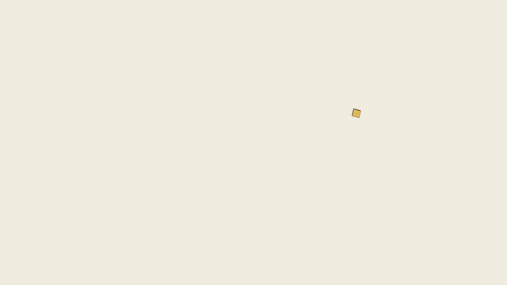

<h1 align="center">TockMux</h1>

<p align="center"><b>Turn any self-playing HTML animation into a frame-perfect MP4, GIF or WebM.</b></p>

<p align="center">
  
</p>

<p align="center">
  <a href="https://github.com/Anand2k29/TockMux/blob/main/promo/tockmux-launch.mp4"><b>Watch the full 30-second launch film (MP4)</b></a><br>
  <a href="#quick-start">Quick start</a> ·
  <a href="#use-the-numbered-menu">Numbered menu</a> ·
  <a href="docs/">Guides</a> ·
  <a href="CONTRIBUTING.md">Contribute</a>
</p>

TockMux takes a web page that moves by itself, opens it in a browser, and takes control of the clock. It then draws
one frame at a time and turns the frames into a video. The result is smooth, the exact size you asked for, and the
same on every computer. No screen recording, no dropped frames.

```bash
npm install -g tockmux
tockmux setup
tockmux
```

Typing `tockmux` on its own opens a numbered menu. You do not need to learn any commands to start.

---

## Contents

1. [Who it is for](#who-it-is-for)
2. [Quick start](#quick-start)
3. [Use the numbered menu](#use-the-numbered-menu)
4. [Make a video from your own HTML](#make-a-video-from-your-own-html)
5. [Make your page work well](#make-your-page-work-well)
6. [Every command](#every-command)
7. [Voice-over and music](#voice-over-and-music)
8. [Title films with `.tmx`](#title-films-with-tmx)
9. [Let an AI assistant make the video (MCP)](#let-an-ai-assistant-make-the-video-mcp)
10. [Use it from code](#use-it-from-code)
11. [What the documents are](#what-the-documents-are)
12. [How it works](#how-it-works)
13. [Troubleshooting](#troubleshooting)
14. [Contributing](#contributing)
15. [Licence and contact](#licence-and-contact)

---

## Who it is for

| You are | TockMux gives you |
| --- | --- |
| A creator posting to TikTok, Shorts, Reels or X | A vertical or square MP4 from one page, with a voice-over that fits |
| Someone who has an animated page from an AI tool | A video file you can post, without screen recording |
| A developer who renders videos in a build or CI job | One function, `convert()`, with the same output every time |
| Someone who wants an AI assistant to make videos | An MCP server, so Claude or Cursor can check, preview and render |
| Someone new to the command line | A numbered menu and a drag-and-drop Studio app |

## Quick start

You need **Node.js 18 or newer**. Check with `node -v`.

```bash
npm install -g tockmux   # installs the tool
tockmux setup            # downloads the browser TockMux draws with (once; skipped if you have Chrome or Edge)
tockmux demo             # makes a sample video, so you can see it work
tockmux                  # opens the numbered menu
```

`tockmux demo` writes `tockmux-demo.mp4` to the folder you run it from. If you run it from a drive root such as `D:\`,
Windows often blocks writing there, so TockMux saves to your home folder instead.

Not sure whether everything is installed? Run `tockmux doctor`. It checks Node, FFmpeg and the browser, and says
what to fix.

---

## Use the numbered menu

Type `tockmux` (or `tockmux menu`) and you will see this:

```
  What do you want to do? Type a number and press Enter.

   1  Make a video from an HTML file I already have
   2  Paste HTML here, then make a video from it
   3  Make a video from a sample (choose 1, 2 or 3)
   4  Surprise me: make a video from a random sample
   5  Watch a file and re-render every time I save it
   6  Check a file first (will it convert well?)
   7  Open the drag-and-drop app in my browser
   8  Check my setup and tell me what to fix
   9  Show me how this works (short guide)
   0  Quit

Your choice:
```

Type a number and press Enter. Each choice asks only what it needs:

| Choice | What happens |
| --- | --- |
| **1** | Asks for the file path. You can drag the file into the window. Then asks how many seconds you want. Press Enter to use the length in the file. |
| **2** | Asks you to paste your HTML. Type `END` on its own line when you have finished. TockMux saves it in a `tockmux-pasted` folder, asks how many seconds, and renders it. |
| **3** | Lists three sample films. Type 1, 2 or 3. |
| **4** | Picks one sample at random and renders it. Good when you want to see something new. |
| **5** | Watches one file. Every time you save it, TockMux renders again. Press Ctrl+C to stop. |
| **6** | Checks a file and tells you whether it will convert well, before a long render. |
| **7** | Opens the drag-and-drop app in your browser. |
| **8** | Runs `doctor`, which checks your setup. |
| **9** | Shows a four-line explanation of how TockMux works. |
| **0** | Quits. |

After each job the menu waits for you to press Enter, then shows the list again.

**Tip:** a number that isn't on the list gets a friendly message and the menu stays open.

---

## Make a video from your own HTML

1. Write a page that moves by itself. A CSS animation is the simplest:

   ```html
   <!doctype html>
   <html>
   <head>
     <meta name="html2mp4:duration" content="6">
     <style>
       body { margin: 0; background: #F4EFE3; }
       .box {
         position: absolute; top: 400px; left: 0;
         width: 200px; height: 200px;
         background: #E3B95C; border: 6px solid #161514;
         animation: move 6s linear infinite;
       }
       @keyframes move { to { left: 1520px; } }
     </style>
   </head>
   <body><div class="box"></div></body>
   </html>
   ```

   Save it as `my.html`.

2. Render it, either from the menu (choice **1**) or from the command line:

   ```bash
   tockmux render my.html
   ```

3. You get `my.mp4` next to your file: a six-second video with the square sliding across the screen.

Try a different size or format:

```bash
tockmux render my.html --preset tiktok     # 1080x1920, vertical
tockmux render my.html --format gif        # an animated GIF
tockmux render my.html --format webm       # WebM
tockmux frame  my.html --at 3s             # one frame, as a picture
```

---

## Make your page work well

Add these tags to the `<head>` of your page. They are optional. Without them TockMux uses 1920x1080 at 30 frames per
second and tries to find the length from your CSS animations.

```html
<meta name="html2mp4:duration" content="12">    <!-- seconds to record -->
<meta name="html2mp4:width"    content="1920">
<meta name="html2mp4:height"   content="1080">
<meta name="html2mp4:start"    content="#go">   <!-- only if a button must be clicked to start -->
```

A button with the id `go`, `play` or `start` is clicked at 0 seconds automatically. TockMux tells you when it guesses.
Turn that off with `--start none`.

### What works

| Works as it is | Needs one option | Does not work |
| --- | --- | --- |
| CSS animations and transitions | Click to start: `--start "#play"` | Pages that need a person to click, type or play during the video |
| `requestAnimationFrame`, `setTimeout`, `setInterval` | Long static page: `--recipe autoscroll` | YouTube, Netflix and other DRM-protected embeds |
| GSAP, anime.js, Lottie | WebGL and three.js (works, slower) | Pages behind a login |
| Canvas and SVG | `<video>` (WebM works best) | Sound made by the page (use `--voice` or `--music`) |
| Pages using `Math.random` (made repeatable) | | |

Not sure? Run `tockmux check my.html`. It opens the page and tells you what it found.

---

## Every command

Every command accepts `--help`, for example `tockmux watch --help`, and `--json` for scripts.

### Make a video

| Command | What it does | Example |
| --- | --- | --- |
| `render` | Turns an `.html` or `.tmx` file into MP4, GIF or WebM | `tockmux render promo.html --preset tiktok` |
| `watch` | Renders again every time you save the file | `tockmux watch promo.html` |
| `batch` | Renders a whole folder or a pattern of files | `tockmux batch ./slides --out-dir ./videos` |
| `check` | Tests whether a file will convert well | `tockmux check promo.html` |
| `frame` | Saves one frame as a picture | `tockmux frame promo.html --at 3s -o poster.png` |
| `sync` | Adds a voice-over and music to an MP4 you already have | `tockmux sync promo.mp4 narration.mp3 -o final.mp4` |
| `probe` | Shows the length, size and audio of a video | `tockmux probe promo.mp4 --frames` |

### Set up and tools

| Command | What it does |
| --- | --- |
| `tockmux` or `tockmux menu` | Opens the numbered menu |
| `setup` | Downloads the browser TockMux draws with (once) |
| `doctor` | Checks Node, FFmpeg and the browser, and says what to fix |
| `demo` | Renders a sample video to prove everything works |
| `init my-video` | Creates a starter project with an HTML film and a `.tmx` script |
| `presets` | Lists the sizes and the title-film themes |
| `tockmux studio` | Opens the drag-and-drop app in your browser |
| `tockmux mcp` | Runs TockMux as an MCP server for AI assistants |
| `voice` | Manages ElevenLabs accounts and makes narration |
| `about` | Shows the version and how to reach the author |

### Sizes (presets)

| Preset | Size | Use it for |
| --- | --- | --- |
| `youtube` (default) | 1920x1080 | YouTube, presentations |
| `hd720` | 1280x720 | Smaller files, quick tests |
| `tiktok` | 1080x1920 | TikTok, Shorts, Reels (vertical) |
| `square` | 1080x1080 | Instagram posts |
| `portrait` | 1080x1350 | Feed posts that are taller than square |
| `cinema` | 1920x1080, 60 fps | Smooth motion |
| `4k` | 3840x2160 | High-resolution masters |

### Useful options

| Option | What it does |
| --- | --- |
| `-o, --output` | Choose the output file |
| `--format mp4`, `webm`, `gif` | Choose the format |
| `--preset` | Choose a size from the table above |
| `--width`, `--height`, `--fps` | Set the size and frame rate exactly |
| `--duration 12s` | Length of the video (also `12` or `1:30`) |
| `--start "#play"` | Click this element at 0 seconds |
| `--seed 1337` | Random seed. The same seed gives the same video |
| `--from 3s --to 8s` | Render only part of the video |
| `--crf 18` | Quality from 0 to 51. Lower is better |
| `--fast` | Faster capture, slightly lower quality |
| `--workers 1` | Use one browser page (safest on slow machines) |
| `--json` | Machine-readable output |
| `--no-color` | Plain text (or set `NO_COLOR=1`) |
| `--debug` | Show the full error details |

---

## Voice-over and music

```bash
tockmux render promo.html --voice narration.mp3 --auto-fit
tockmux render promo.html --voice narration.mp3 --music bg.mp3 --duck
tockmux sync promo.mp4 narration.mp3 --stretch -o final.mp4
```

- `--auto-fit` stretches the animation to the length of the narration, so the words and the motion end together.
- `--music` adds background music. `--duck` lowers the music while the voice speaks.
- `sync` adds audio to an MP4 you already rendered.

### ElevenLabs narration (optional)

```bash
tockmux voice add --name main            # asks for your API key privately
tockmux voice status --refresh           # real usage from ElevenLabs
tockmux voice speak "Welcome to our product." -o narration.mp3
```

Keys are stored in `~/.tockmux/voice.json` with owner-only permissions. They are never written into your project.
Use keys for accounts you are allowed to use. Creating many accounts to get around a provider's limits can break its
terms.

---

## Title films with `.tmx`

A `.tmx` file is a short script for a title film. No HTML needed.

```
film "Launch" duration=6s preset=youtube theme=midnight
watermark "mybrand.com"

scene 0s..3s transition=pop {
  badge "New"
  title "Ship videos like you ship code" highlight="ship code"
  subtitle "Write it once. Render it anywhere."
}
scene 3s..6s transition=zoom {
  counter from=0 to=100 suffix="% done"
  bar percent=100
  caption "Made with TockMux"
}
```

| Part | Options |
| --- | --- |
| Elements | `badge`, `title`, `subtitle`, `code`, `counter`, `bar`, `list`, `quote`, `image`, `caption` |
| Transitions | `pop`, `slide`, `zoom`, `fade`, `none` |
| Themes | `midnight`, `paper`, `sunset`, `ocean`, `mono` |

Mistakes are reported with the line number and a suggestion for the fix. Start from a sample with `tockmux init my-video`.

---

## Let an AI assistant make the video (MCP)

MCP (Model Context Protocol) is a standard way for AI tools to use other tools. TockMux can run as an MCP server, so
an assistant can make videos for you when you ask in plain words.

```bash
claude mcp add tockmux -- npx -y tockmux mcp     # Claude Code
tockmux mcp --print-config                       # JSON for Claude Desktop, Cursor or another MCP client
```

The assistant gets these tools:

| Tool | What it does for the assistant |
| --- | --- |
| `check_html` | Tests whether a page will convert well |
| `snapshot_frame` | Shows one frame as a picture, so it can check the design |
| `render_video` | Renders the MP4, GIF or WebM |
| `compile_tmx` | Turns a `.tmx` script into HTML |
| `list_presets` | Lists sizes and themes |
| `probe_media` | Reads the length and size of a video or audio file |
| `speak_text` | Makes narration (needs an ElevenLabs key) |

The assistant can only read and write inside the folder you start it in.

---

## Use it from code

```js
import { convert } from "tockmux";

const result = await convert({
  input: "promo.html",
  flags: { output: "promo.mp4", preset: "tiktok" }
});
console.log(result.output, result.durationSec);
```

`convert()` returns the output path, the duration, the size, the file size, the time taken and any warnings. Use it in
a build script, a CI job, or a back end.

---

## What the documents are

TockMux has several kinds of documents. People often mix them up, so here is what each one is.

| Name | What it is | Is it a language? |
| --- | --- | --- |
| **This README** | The front page of the project: what TockMux is, how to start, and where to look next. | No. It is a Markdown document, a plain-text file with simple formatting. |
| **`docs/`** | Guides for people who use TockMux: the problem it solves, setup, publishing, MCP, architecture and the test report. | No. Markdown guides. |
| **`process/`** | Internal notes from building TockMux: the decisions and why they were made, the MVP, how the functions call each other, the flow of a render, and the usage guide. | No. Notes for the people who maintain TockMux. |
| **`CONTRIBUTING.md`** | How to report problems and send changes. | No. |
| **`.tmx` files** | Scripts for title films. | **Yes, a small language.** It is TockMux's own format for writing a film as a short script. |
| **HTML pages** | The animation you give TockMux. | HTML is a language, but TockMux only needs it to be a page that moves by itself. |
| **MCP** | A protocol. It lets AI tools call TockMux's tools. | No. It is a way of connecting, not a language. |
| **The npm package** | What you install with `npm install -g tockmux`. It contains the command line, the library, Studio and the MCP server. | No. It is a program. |

So: TockMux is a **program** you install. Its **`.tmx` format** is the only small language it has. **MCP** is an
optional door for AI tools. The **documents** are just guides to read.

---

## How it works

A normal browser animates against the wall clock, so a screen recording stutters and differs between runs. TockMux
injects a virtual clock before your page loads. Timers, animation frames, `Date`, `performance.now()`, CSS animations,
and videos only move forward when TockMux says so.

For every frame, TockMux advances the clock by exactly one frame, lets the page react, takes a picture through the
browser's debugging protocol, and sends the picture to FFmpeg. Long videos are split into segments that render in
parallel, then joined without re-encoding.

The test suite checks this. A square moving at 100 pixels per second lands on exactly the same pixel at the same frame,
every time.

For a step-by-step explanation of the code, read [`process/flow.md`](process/flow.md) and [`process/functions.mvp`](process/functions.mvp).

---

## Troubleshooting

| What you see | What to do |
| --- | --- |
| "No browser found" | Run `tockmux setup`, or install Chrome or Edge |
| "No length found, using 10s" | Add the `html2mp4:duration` meta tag, or pass `--duration 12` |
| The video is a still image | The page does not move by itself. Run `tockmux check` to see why |
| The page waits for a click | Add `--start "#your-button"` |
| The render stops partway with "browser has been closed" | Run again with `--workers 1 --fast` |
| "EPERM" or "operation not permitted" when writing | Run from a folder inside your user profile, not a drive root such as `D:\` |
| Watch does not notice saves | Stop it (Ctrl+C) and run `tockmux watch` again |
| Anything else | Run again with `--debug` and send the output to **Spidey_Moon** on Discord |

---

## Contributing

Contributions are welcome. Please read [CONTRIBUTING.md](CONTRIBUTING.md) first. It explains how to report a problem,
how to set up the project, what a good change looks like, and what the project will and will not accept.

---

## Licence and contact

- Licence: MIT. See [LICENSE](LICENSE).
- Discord: **Spidey_Moon**
- GitHub: **[Anand2k29](https://github.com/Anand2k29)**
