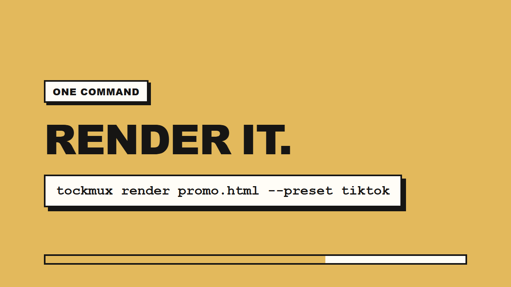

# TockMux

**Turn any self-playing HTML animation into a frame-perfect MP4, GIF or WebM.**

TockMux opens your page in a browser, takes control of the clock, and draws one frame at a time. The video comes out
smooth, the exact size you asked for, and identical on every computer. No screen recorder, no dropped frames.

```bash
npx tockmux demo          # renders a sample video, proves everything works
```

[](promo/tockmux-promo.mp4)

**Watch the 18-second promo:** [tockmux-promo.mp4](tockmux-promo.mp4) (made by TockMux itself, from a plain HTML page).

## Why TockMux

Animated web pages are easy to make now, and hard to post. A screen recording stutters, changes every time, and comes out
the wrong size. TockMux records the page on a clock it controls, so:

- **Same every run.** Re-render and get the same frames, on any computer.
- **Exact size.** TikTok 1080x1920, YouTube 1920x1080, square, 4K, or your own size.
- **One command.** No editor to open. `tockmux watch` re-renders each time you save.
- **Voice that fits.** `--auto-fit` stretches the animation to your narration.
- **Works with AI.** An MCP server lets Claude and Cursor make the video for you.

## Install (2 minutes)

You need [Node.js 18 or newer](https://nodejs.org). Then:

```bash
npm install -g tockmux
tockmux setup             # one time: downloads the browser it draws with (skipped if you have Chrome/Edge)
tockmux demo              # renders tockmux-demo.mp4
```

Prefer not to install anything? Put `npx` in front: `npx tockmux render my.html`.

## Use it

```bash
tockmux check  my.html                      # will it convert well? (opens it in a browser and tests it)
tockmux render my.html                      # -> my.mp4 next to the file
tockmux watch  my.html                      # re-render every time you save
tockmux render my.html --preset tiktok      # 1080x1920 vertical
tockmux render my.html --format gif         # a GIF instead
tockmux render my.html --voice voice.mp3 --auto-fit    # stretch the animation to fit your narration
tockmux frame  my.html --at 3s              # save one frame as a poster image
tockmux batch  ./slides --out-dir ./videos  # render a whole folder
tockmux studio                              # drag-and-drop app in your browser
```

No HTML yet? `tockmux init my-video` creates a starter project, or write a short `.tmx` script (see below).

### Make your HTML ready (all optional, but it helps)

```html
<meta name="html2mp4:duration" content="12">   <!-- how many seconds to record -->
<meta name="html2mp4:width"    content="1920">
<meta name="html2mp4:height"   content="1080">
<meta name="html2mp4:start"    content="#go">   <!-- only if a button must be clicked to start -->
```

Without them TockMux uses 1920x1080 at 30 fps and tries to detect the length from CSS animations.
A button with the id `go`, `play` or `start` is clicked at 0 s automatically (it tells you when it guesses;
`--start none` turns that off).

## What works, and what does not

| Works as it is | Needs one option | Does not work |
| --- | --- | --- |
| CSS animations and transitions | Click to start: `--start "#play"` | Pages needing a person to click or type during the video |
| `requestAnimationFrame`, `setTimeout`, `setInterval` | Long static page: `--recipe autoscroll` | YouTube / DRM embeds |
| GSAP, anime.js, Lottie | WebGL / three.js (software drawing, slower) | Pages behind a login |
| Canvas and SVG | `<video>` (WebM works best) | Sound made by the page (pass `--voice` / `--music` instead) |
| Pages using `Math.random` (made repeatable) | | |

## Voice-over and music

```bash
tockmux render promo.html --voice narration.mp3 --auto-fit        # animation stretched to the voice
tockmux render promo.html --voice narration.mp3 --music bg.mp3 --duck   # music dips while the voice speaks
tockmux sync promo.mp4 narration.mp3 --stretch -o final.mp4       # add audio to an MP4 you already have
```

### ElevenLabs narration

```bash
tockmux voice add --name main            # asks for your API key privately
tockmux voice add --name backup          # add more accounts if you have them
tockmux voice status --refresh           # real usage from ElevenLabs
tockmux voice speak "Welcome to our product." -o narration.mp3
```

Keys are stored in `~/.tockmux/voice.json` (owner-only permissions), never in your project folder. When an account runs
out of characters or a key is invalid, TockMux moves to the next one and can split long scripts across accounts.
Use keys from accounts you are entitled to use (your own plans, team workspaces): creating many free accounts to get
around a provider's limits can violate its terms.

## `.tmx`: videos without HTML

```
film "Launch" duration=6s preset=youtube theme=midnight
watermark "mybrand.com"

scene 0s..3s transition=pop {
  badge "New"
  title "Ship videos like you ship code" highlight="ship code"
  subtitle "Write it once. Render it anywhere."
}
scene 3s..6s transition=zoom {
  counter from=0 to=100 suffix="% done"
  bar percent=100
  caption "Made with TockMux"
}
```

Elements: `badge title subtitle code counter bar list quote image caption`.
Transitions: `pop slide zoom fade none`. Themes: `midnight paper sunset ocean mono`. Mistakes are reported with line
numbers and suggestions. Run `tockmux presets` for sizes and themes.

## Let an AI assistant make the video (MCP)

```bash
claude mcp add tockmux -- npx -y tockmux mcp         # Claude Code
tockmux mcp --print-config                           # JSON for Claude Desktop / Cursor
```

The assistant gets tools to check a page, preview frames as images, and render the MP4, plus a guide on how to write
compatible HTML. It can only read and write inside the folder you start it in.

## Use it as a library

```js
import { convert } from "tockmux";
const result = await convert({ input: "promo.html", flags: { output: "promo.mp4", preset: "tiktok" } });
console.log(result.output, result.durationSec);
```

## How it works

A normal browser animates against the wall clock, so recordings stutter and differ between runs. TockMux injects a
virtual clock before your page loads: timers, animation frames, `Date`, `performance.now()`, CSS animations and
videos only advance when TockMux says so. For each frame it advances the clock, takes a screenshot through the browser's
debugging protocol, and pipes it to FFmpeg. Long videos are split across parallel browser pages.

More: [docs/](docs/) has the full guides (problem and solution, setup, publishing, MCP, architecture).

## Troubleshooting

Run `tockmux doctor`. It checks Node, FFmpeg and the browser and tells you what to fix. `tockmux check my.html` tells
you whether a page will convert well. Still stuck? Discord: **Spidey_Moon**.

## Licence

MIT.
