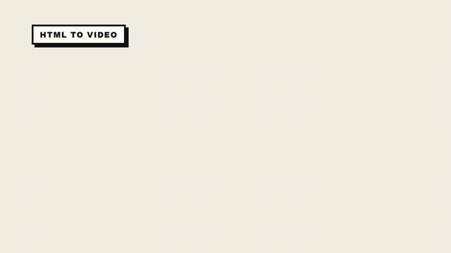
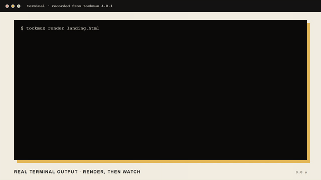
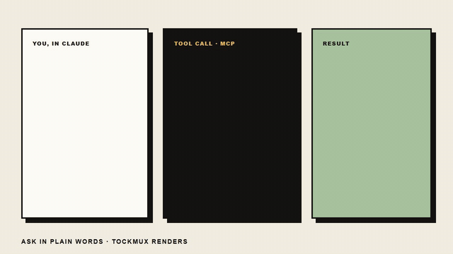

<div align="center">

# 🎬 TockMux

### Turn any self-playing HTML animation into a frame-perfect MP4, GIF or WebM.

[](https://www.npmjs.com/package/tockmux)
[](LICENSE)
[](#-quick-start)
[](#-claude-code-plugin)



**[▶ Watch the full 20-second film (MP4)](https://github.com/Anand2k29/TockMux/blob/main/promo/tockmux-readme.mp4)**

[Quick start](#-quick-start) · [Menu](#-the-numbered-menu) · [Your HTML](#-make-a-video-from-your-own-html) · [Commands](#-every-command) · [Limits](#-what-you-can-make-and-the-limits) · [Plugin](#-claude-code-plugin) · [Contribute](CONTRIBUTING.md)

</div>

---

TockMux takes a web page that moves by itself, opens it in a browser, and **takes control of the clock**. It draws one
frame at a time and turns the frames into a video. The result is smooth, the exact size you asked for, and the same on
every computer. No screen recording, no dropped frames.

```bash
npm install -g tockmux
tockmux setup
tockmux
```

> [!TIP]
> Typing `tockmux` on its own opens a numbered menu. You don't need to learn any commands to start.

---

## ✨ At a glance

| | |
| :--- | :--- |
| 🎞️ **Output** | MP4 (with sound), GIF, or WebM |
| 📐 **Sizes** | YouTube, HD, TikTok vertical, square, portrait, cinema 60 fps, 4K |
| ⏱️ **Length** | Up to 1 hour per video. Set it with `--duration` or a meta tag |
| 🎙️ **Voice** | Add narration or music, with `--auto-fit` to stretch the animation to the voice |
| 🔁 **Repeatable** | The same page gives the same video every time |
| 🧭 **Ways in** | Numbered menu, command line, Studio app, library import, MCP, Claude Code plugin |

---

## 👥 Who it is for

| You are | TockMux gives you |
| :--- | :--- |
| 📱 A creator posting to TikTok, Shorts, Reels or X | A vertical or square MP4 from one page, with a voice-over that fits |
| 🤖 Someone with an animated page from an AI tool | A video file you can post, without screen recording |
| 🛠️ A developer rendering videos in a build or CI job | One function, `convert()`, with the same output every time |
| 💬 Someone who wants an AI assistant to make videos | An MCP server, plus a Claude Code plugin with `/tockmux` commands |
| 🌱 Someone new to the command line | A numbered menu and a drag-and-drop Studio app |

---

## 🚀 Quick start

> [!NOTE]
> You need **Node.js 20 or newer**. The browser installer requires Node 20. Check with `node -v`.

**1.** Install the tool:

```bash
npm install -g tockmux
```

**2.** Download the browser TockMux draws with. This is a one-time step, and it's skipped if you already have Chrome or Edge:

```bash
tockmux setup
```

**3.** Make a sample video so you can see it work:

```bash
tockmux demo
```

**4.** Open the menu, or check your setup:


```bash
tockmux          # the numbered menu
tockmux doctor   # checks Node, FFmpeg and the browser, and says what to fix
```

> [!WARNING]
> `tockmux demo` saves to the folder you run it from. If you run it from a drive root such as `D:\`, Windows often
> blocks writing there, so TockMux saves to your home folder instead.

---

### 🎥 See it run in a terminal

<div align="center">



**[▶ Watch the full recording (MP4, 53 s)](https://github.com/Anand2k29/TockMux/blob/main/promo/demo-recording.mp4)**

*A recording of real output from two runs of the commands above, not a mock-up.*

</div>

## 🧭 The numbered menu

Type `tockmux` (or `tockmux menu`):

```
  What do you want to do? Type a number and press Enter.

   1  Make a video from an HTML file I already have
   2  Paste HTML here, then make a video from it
   3  Make a video from a sample (choose 1, 2 or 3)
   4  Surprise me: make a video from a random sample
   5  Watch a file and re-render every time I save it
   6  Check a file first (will it convert well?)
   7  Open the drag-and-drop app in my browser
   8  Check my setup and tell me what to fix
   9  Show me how this works (short guide)
   0  Quit
```

| # | What happens |
| :---: | :--- |
| **1** | Asks for the file. Drag it into the window. Then asks how many seconds (Enter uses the length in the file). |
| **2** | Asks you to paste your HTML. Type `END` on its own line. TockMux saves it in `tockmux-pasted/`, asks for seconds, and renders. |
| **3** | Lists three sample films. Type 1, 2 or 3. |
| **4** | Picks one sample at random. Good when you want to see something new. |
| **5** | Watches one file and renders on every save. Ctrl+C stops it. |
| **6** | Checks a file before a long render. |
| **7** | Opens the drag-and-drop app in your browser. |
| **8** | Runs `doctor`. |
| **9** | A four-line explanation of how TockMux works. |
| **0** | Quit. |

A number that isn't on the list gets a friendly message, and the menu stays open.

---

## 🎨 Make a video from your own HTML

**1. Write a page that moves by itself.** A CSS animation is the simplest:

```html
<!doctype html>
<html>
<head>
  <meta name="html2mp4:duration" content="6">
  <style>
    body { margin: 0; background: #F4EFE3; }
    .box {
      position: absolute; top: 400px; left: 0;
      width: 200px; height: 200px;
      background: #E3B95C; border: 6px solid #161514;
      animation: move 6s linear infinite;
    }
    @keyframes move { to { left: 1520px; } }
  </style>
</head>
<body><div class="box"></div></body>
</html>
```

Save it as `my.html`.

**2. Render it:**

```bash
tockmux render my.html
```

**3. Collect the result.** You get `my.mp4` next to your file: a six-second video with the square sliding across the screen.

Try another size or format:

```bash
tockmux render my.html --preset tiktok     # 1080x1920, vertical
tockmux render my.html --format gif        # an animated GIF
tockmux render my.html --format webm       # WebM
tockmux frame  my.html --at 3s             # one frame, as a picture
```

<details>
<summary><b>⚙️ Make your page work well (optional tags)</b></summary>

Add these tags to the `<head>`. Without them TockMux uses 1920x1080 at 30 fps and tries to find the length from your CSS.

```html
<meta name="html2mp4:duration" content="12">    <!-- seconds to record -->
<meta name="html2mp4:width"    content="1920">
<meta name="html2mp4:height"   content="1080">
<meta name="html2mp4:start"    content="#go">   <!-- only if a button must be clicked to start -->
```

A button with the id `go`, `play` or `start` is clicked at 0 seconds automatically. TockMux tells you when it guesses.
Turn that off with `--start none`.

| ✅ Works as it is | 🔧 Needs one option | ❌ Doesn't work |
| :--- | :--- | :--- |
| CSS animations and transitions | Click to start: `--start "#play"` | Pages that need a click, typing or a login during the video |
| `requestAnimationFrame`, timers | Long static page: `--recipe autoscroll` | YouTube, Netflix and other DRM-protected embeds |
| GSAP, anime.js, Lottie | WebGL and three.js (works, slower) | Pages behind a login |
| Canvas and SVG | `<video>` (WebM works best) | Sound made by the page (use `--voice` or `--music`) |
| `Math.random` (made repeatable) | | |

Not sure? Run `tockmux check my.html`.

</details>

---

## 📚 Every command

Every command accepts `--help`, for example `tockmux watch --help`, and `--json` for scripts.

<details open>
<summary><b>🎬 Make a video</b></summary>

| Command | What it does | Example |
| :--- | :--- | :--- |
| `render` | Turns an `.html` or `.tmx` file into MP4, GIF or WebM | `tockmux render promo.html --preset tiktok` |
| `watch` | Renders again every time you save | `tockmux watch promo.html` |
| `batch` | Renders a whole folder or a pattern | `tockmux batch ./slides --out-dir ./videos` |
| `check` | Tests whether a file will convert well | `tockmux check promo.html` |
| `frame` | Saves one frame as a picture | `tockmux frame promo.html --at 3s -o poster.png` |
| `sync` | Adds a voice-over and music to an MP4 you have | `tockmux sync promo.mp4 narration.mp3 -o final.mp4` |
| `probe` | Shows the length, size and audio of a video | `tockmux probe promo.mp4 --frames` |

</details>

<details>
<summary><b>🧰 Set up and tools</b></summary>

| Command | What it does |
| :--- | :--- |
| `tockmux` or `tockmux menu` | Opens the numbered menu |
| `setup` | Downloads the browser TockMux draws with (once) |
| `doctor` | Checks Node, FFmpeg and the browser, and says what to fix |
| `demo` | Renders a sample video to prove everything works |
| `init my-video` | Creates a starter project with an HTML film and a `.tmx` script |
| `presets` | Lists the sizes and the title-film themes |
| `tockmux studio` | Opens the drag-and-drop app in your browser |
| `tockmux mcp` | Runs TockMux as an MCP server for AI assistants |
| `voice` | Manages ElevenLabs accounts and makes narration |
| `about` | Shows the version and how to reach the author |

</details>

<details>
<summary><b>📐 Sizes (presets)</b></summary>

| Preset | Size | Use it for |
| :--- | :--- | :--- |
| `youtube` (default) | 1920x1080 | YouTube, presentations |
| `hd720` | 1280x720 | Smaller files, quick tests |
| `tiktok` | 1080x1920 | TikTok, Shorts, Reels (vertical) |
| `square` | 1080x1080 | Instagram posts |
| `portrait` | 1080x1350 | Feed posts taller than square |
| `cinema` | 1920x1080, 60 fps | Smooth motion |
| `4k` | 3840x2160 | High-resolution masters |

</details>

<details>
<summary><b>🎛️ Useful options</b></summary>

| Option | What it does |
| :--- | :--- |
| `-o, --output` | Choose the output file |
| `--format mp4`, `webm`, `gif` | Choose the format |
| `--preset` | Choose a size from the table above |
| `--width`, `--height`, `--fps` | Set the size and frame rate exactly |
| `--duration 12s` | Length of the video (also `12` or `1:30`) |
| `--start "#play"` | Click this element at 0 seconds |
| `--seed 1337` | Random seed. The same seed gives the same video |
| `--from 3s --to 8s` | Render only part of the video |
| `--crf 18` | Quality from 0 to 51. Lower is better |
| `--fast` | Faster capture, slightly lower quality |
| `--workers 1` | Use one browser page (safest on slow machines) |
| `--json` | Machine-readable output |
| `--no-color` | Plain text (or set `NO_COLOR=1`) |
| `--debug` | Show the full error details |

</details>

---

## 🎙️ Voice-over and music

```bash
tockmux render promo.html --voice narration.mp3 --auto-fit
tockmux render promo.html --voice narration.mp3 --music bg.mp3 --duck
tockmux sync promo.mp4 narration.mp3 --stretch -o final.mp4
```

- **`--auto-fit`** stretches the animation to the length of the narration, so the words and the motion end together.
- **`--music`** adds background music. **`--duck`** lowers it while the voice speaks.
- **`sync`** adds audio to an MP4 you already rendered.

<details>
<summary><b>🔑 ElevenLabs narration (optional)</b></summary>

```bash
tockmux voice add --name main            # asks for your API key privately
tockmux voice status --refresh           # real usage from ElevenLabs
tockmux voice speak "Welcome to our product." -o narration.mp3
```

Keys are stored in `~/.tockmux/voice.json` with owner-only permissions. They are never written into your project. Use
keys for accounts you are allowed to use. Creating many accounts to get around a provider's limits can break its terms.

</details>

---

## 🎞️ Title films with `.tmx`

A `.tmx` file is a short script for a title film. No HTML needed:

```
film "Launch" duration=6s preset=youtube theme=midnight
watermark "mybrand.com"

scene 0s..3s transition=pop {
  badge "New"
  title "Ship videos like you ship code" highlight="ship code"
  subtitle "Write it once. Render it anywhere."
}
scene 3s..6s transition=zoom {
  counter from=0 to=100 suffix="% done"
  bar percent=100
  caption "Made with TockMux"
}
```

| Part | Options |
| :--- | :--- |
| 🧱 Elements | `badge`, `title`, `subtitle`, `code`, `counter`, `bar`, `list`, `quote`, `image`, `caption` |
| 🎬 Transitions | `pop`, `slide`, `zoom`, `fade`, `none` |
| 🎨 Themes | `midnight`, `paper`, `sunset`, `ocean`, `mono` |

Mistakes are reported with the line number and a suggestion. Start from a sample with `tockmux init my-video`.

---

## 🤖 Let an AI assistant make the video (MCP)

MCP (Model Context Protocol) is a standard way for AI tools to use other tools. TockMux can run as an MCP server, so an
assistant can make videos when you ask in plain words.

<div align="center">



**[▶ Watch the MCP demo (10 s, MP4)](https://github.com/Anand2k29/TockMux/blob/main/promo/demo-mcp.mp4)**

</div>

> [!NOTE]
> The demo is an animated illustration of the exact tool call and result, rendered by TockMux from HTML.

```bash
claude mcp add tockmux -- npx -y tockmux mcp     # Claude Code
tockmux mcp --print-config                       # JSON for Claude Desktop, Cursor or another MCP client
```

| Tool | What it does for the assistant |
| :--- | :--- |
| `check_html` | Tests whether a page will convert well |
| `snapshot_frame` | Shows one frame as a picture, so it can check the design |
| `render_video` | Renders the MP4, GIF or WebM |
| `compile_tmx` | Turns a `.tmx` script into HTML |
| `list_presets` | Lists sizes and themes |
| `probe_media` | Reads the length and size of a video or audio file |
| `speak_text` | Makes narration (needs an ElevenLabs key) |

> [!NOTE]
> The assistant can only read and write inside the folder you start it in.

---

## 🧩 Claude Code plugin

TockMux works inside Claude Code with `/tockmux` commands. Install it with two commands:

```
/plugin marketplace add Anand2k29/TockMux
/plugin install tockmux@tockmux
```

| Command | What it does |
| :--- | :--- |
| `/tockmux:render <file>` | Renders an HTML or `.tmx` file to MP4, GIF or WebM |
| `/tockmux:watch <file>` | Re-renders every time you save |
| `/tockmux:check <file>` | Checks whether the file will convert well |
| `/tockmux:make <description>` | Writes an animated page from your description, then renders it |
| `/tockmux:setup` | Checks your setup and runs the demo |

Full details: [`claude-plugin/README.md`](claude-plugin/README.md).

---

## 💻 Use it from code

```js
import { convert } from "tockmux";

const result = await convert({
  input: "promo.html",
  flags: { output: "promo.mp4", preset: "tiktok" }
});
console.log(result.output, result.durationSec);
```

`convert()` returns the output path, the duration, the size, the file size, the time taken, and any warnings.

---

## 🔍 How it works

A normal browser animates against the wall clock, so a screen recording stutters and differs between runs. TockMux
injects a **virtual clock** before your page loads. Timers, animation frames, `Date`, `performance.now()`, CSS
animations and videos only move forward when TockMux says so.

For every frame, TockMux advances the clock by exactly one frame, lets the page react, takes a picture through the
browser's debugging protocol, and sends it to FFmpeg. Long videos render in parallel segments, then join without
re-encoding.

> [!TIP]
> The test suite checks this. A square moving at 100 pixels per second lands on exactly the same pixel at the same
> frame, every time.

For the step-by-step code walk-through, read [`process/flow.md`](process/flow.md) and [`process/functions.mvp`](process/functions.mvp).

---

## 📏 What you can make, and the limits

<details open>
<summary><b>📁 Files TockMux accepts</b></summary>

| File | What it is for | Notes |
| :--- | :--- | :--- |
| `.html`, `.htm` | A page that moves by itself | The main input. CSS, JavaScript, canvas, SVG, GSAP and Lottie all work. |
| `.tmx` | A title film written as a short script | No HTML needed. See [Title films](#-title-films-with-tmx). |
| `.mp4` | An existing video, for `sync` | Add a voice-over or music to it. |
| `.mp3` (and other audio) | Voice-over or music, for `--voice` and `--music` | MP3 is the format that is tested. |

Anything else, such as `.txt`, `.pdf`, `.docx`, or a lone `.png` or `.jpg`, is refused with "Unsupported file type".
Images and fonts a page uses are fine, as long as the page can reach them.

</details>

<details open>
<summary><b>⏱️ How long a video can be</b></summary>

- **Maximum:** 3600 seconds (one hour).
- **Default:** 10 seconds, if the page doesn't declare a length and you don't pass `--duration`.
- **Setting the length:** `--duration 20` (or `20s`, or `1:30`), or `<meta name="html2mp4:duration" content="20">` in the page.
- **Render time** grows with length. A 30-second 1280x720 film takes about 40 to 50 seconds with `--fast`. Test a short version first.
- **Frame limits:** width and height from 16 to 7680 pixels, frame rate from 1 to 120 fps.

</details>

<details open>
<summary><b>🎞️ What kinds of video you can make</b></summary>

| Output | Audio | Use it for |
| :--- | :---: | :--- |
| MP4 (default) | ✅ | Social posts, presentations, promo films, anything you upload |
| GIF | ❌ | Readme previews, chat, short loops |
| WebM | ❌ | Web embeds |

Typical videos: promo films, animated explainers, social clips, slide-style animations, short GIFs for readmes, and
title films. You can also save one frame as a poster with `tockmux frame`.

</details>

<details open>
<summary><b>🚫 What it cannot record</b></summary>

- Pages that need a click, typing or a login during the video. A single click at the start works with `--start "#button"`.
- Sound that the page plays itself. Use `--voice` or `--music` instead.
- Protected embeds such as YouTube or Netflix.

</details>

<details open>
<summary><b>🖼️ From a landing page to a promo video</b></summary>

There are two cases:

**1. The page already moves.** Render it with a length:

```bash
npx -y tockmux render landing.html --duration 20
```

Or in Claude Code: `/tockmux:render landing.html --duration 20`. The video records exactly 20 seconds. Anything after that
is not recorded.

**2. The page is static.** The render would be a still image, so the page needs an animation first. Describe the look
with `/tockmux:make`, for example:

```
/tockmux:make a 20-second promo in the style of landing.html, warm colours, --duration 20
```

Claude writes a new animated page to match, and TockMux renders it. Claude doesn't read `landing.html` as a source yet,
so describe the look you want.

> [!TIP]
> Run `npx -y tockmux check landing.html` first. It tells you whether the page moves before you wait for a render.

</details>

---

## 🛟 Troubleshooting

| What you see | What to do |
| :--- | :--- |
| "No browser found" | Run `tockmux setup`, or install Chrome or Edge |
| "No length found, using 10s" | Add the `html2mp4:duration` meta tag, or pass `--duration 12` |
| The video is a still image | The page doesn't move by itself. Run `tockmux check` to see why |
| The page waits for a click | Add `--start "#your-button"` |
| "browser has been closed" partway through | Run again with `--workers 1 --fast` |
| "EPERM" or "operation not permitted" | Run from a folder inside your user profile, not a drive root such as `D:\` |
| Watch doesn't notice saves | Stop it (Ctrl+C) and run `tockmux watch` again |
| Anything else | Run again with `--debug` and send the output to **Spidey_Moon** on Discord |

---

## 🗂️ The documents in this project

| Folder or file | What it is | Is it a language? |
| :--- | :--- | :--- |
| 📄 **This README** | The front page: what TockMux is, how to start, where to look next | No. Markdown, plain text with simple formatting. |
| 📘 **`docs/`** | Guides for people who use TockMux | No. Markdown guides. |
| 🧠 **`process/`** | Internal notes: decisions, MVP, how functions call each other, the render flow | No. Notes for maintainers (not shipped to npm). |
| 🤝 **`CONTRIBUTING.md`** | How to report problems and send changes | No. |
| 🎞️ **`.tmx` files** | Scripts for title films | **Yes, a small language**, TockMux's own format. |
| 🌐 **HTML pages** | The animation you give TockMux | HTML is a language. TockMux only needs a page that moves by itself. |
| 🔌 **MCP** | A protocol that lets AI tools call TockMux | No. It's a way of connecting. |
| 📦 **The npm package** | What `npm install -g tockmux` installs | No. It's a program. |

**In short:** TockMux is a **program**. Its **`.tmx` format** is the only small language it has. **MCP** is an optional
door for AI tools. The **documents** are guides to read.

---

## 🤝 Contributing

Contributions are welcome. Start with [CONTRIBUTING.md](CONTRIBUTING.md). It covers how to report a problem, how to set
up the project, what a good change looks like, and where help is most needed (macOS and Linux support, CI, and more).

---

## 📬 Licence and contact

<div align="center">

**Licence:** MIT. See [LICENSE](LICENSE).

**Discord:** `Spidey_Moon` · **GitHub:** [Anand2k29](https://github.com/Anand2k29)

</div>
