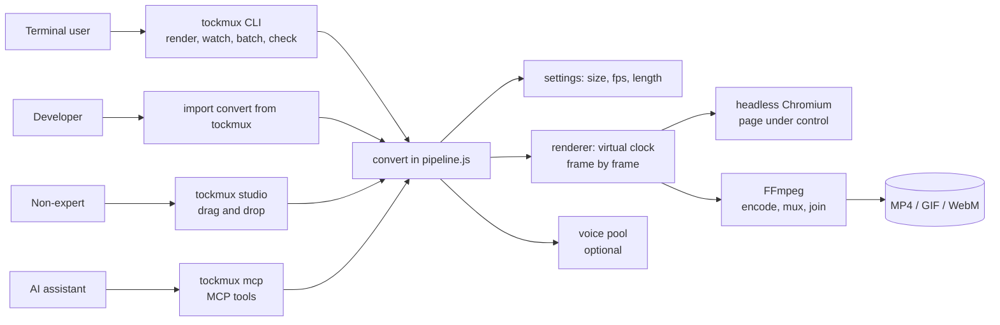
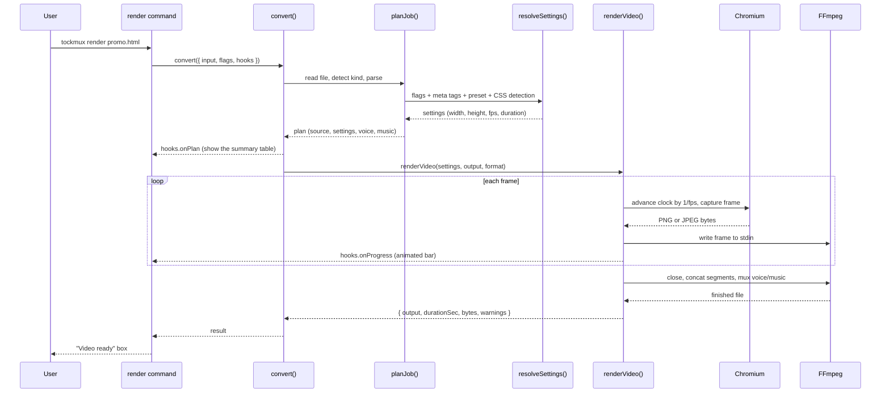
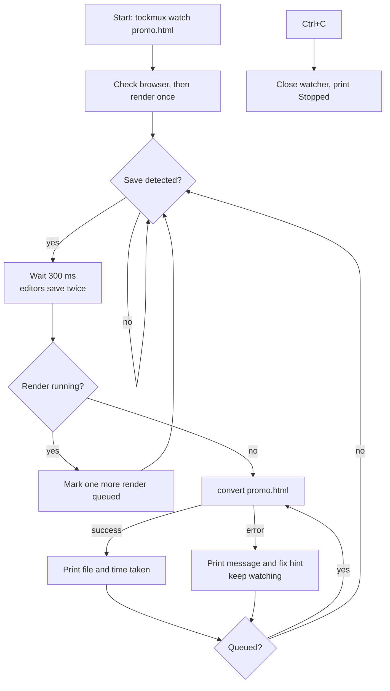
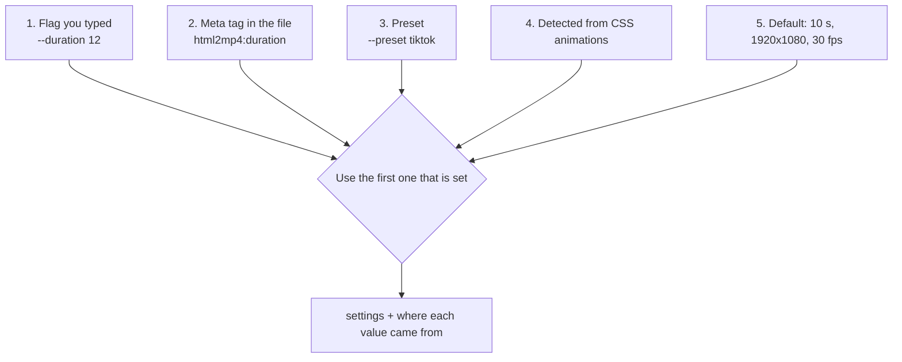
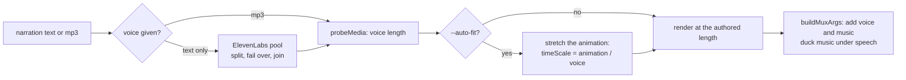
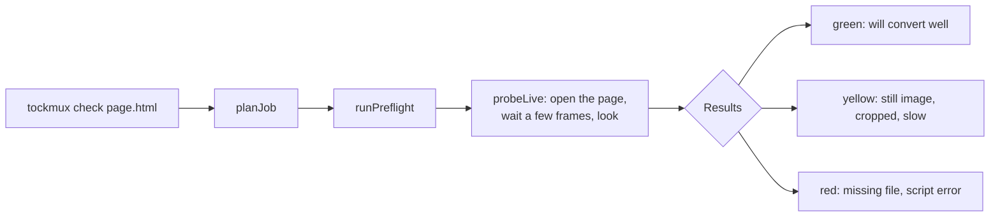
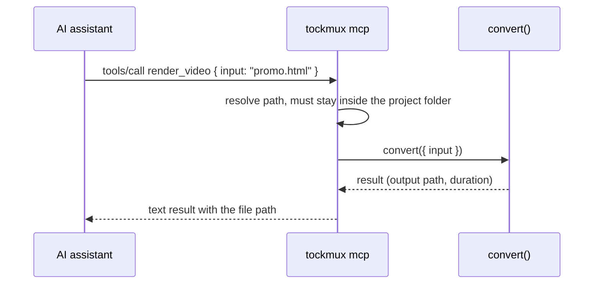

# Flow

How a request becomes a video. Each diagram can be read top to bottom. The names match `functions.mvp`.

## 1. The whole product, one picture

## 2. A render, step by step

## 3. The watch loop

## 4. Choosing the settings (what wins)

The summary table shows the source of each value ("set by you", "from the file", "preset", "detected", "default"),
so a user can see why a video is the length it is.

## 5. Voice-over with auto-fit

## 6. Check before you wait

## 7. The MCP call path

## 8. Failure paths (all turn into plain sentences)

| Where it fails | What the user sees | Where it is caught |
| --- | --- | --- |
| File missing | "File not found: x" + "check the spelling" | `planJob` |
| Bad `.tmx` line | line number, the bad word, a suggestion | `parseTmx` / `assertValidTmx` |
| No browser | offer to download once | `ensureBrowser` |
| Page throws an error | the script error and where it happened | `renderVideo` and preflight |
| ElevenLabs quota or bad key | "switching to the next account" | `VoicePool` |
| FFmpeg error | the last lines of FFmpeg's error output | `runFfmpeg` |
| Anything unexpected | "Something unexpected went wrong" + `--debug` | `main.js` |
